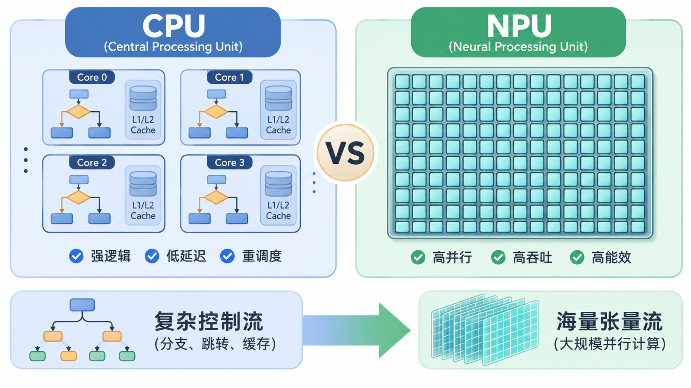
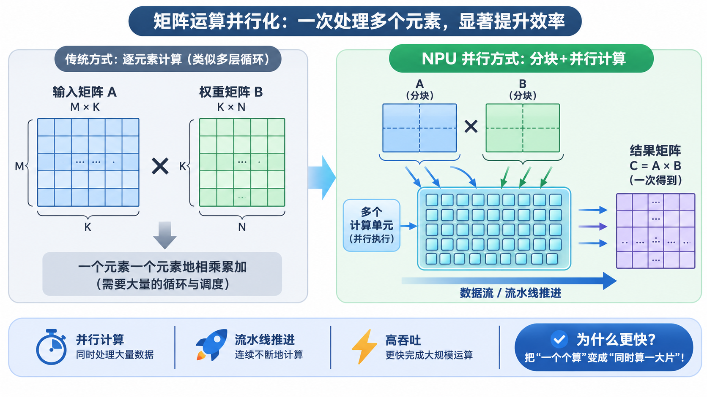

什么是 NPU

神经网络处理器：专为 AI 计算设计的硬件加速器，核心优势是高并行与高能效。

NPU vs CPU

分工不同：CPU 擅长复杂逻辑、分支判断与系统调度；NPU 专注海量乘加与矩阵运算。

结构不同：CPU 核心少、单核强，控制电路复杂；NPU 拥有海量精简计算单元，适合大规模同质计算。

能效不同：NPU 针对 AI 数据流优化，避免频繁调度与数据搬运开销，同功耗下 AI 吞吐量远高于 CPU。

怎么并行：体现在哪里
计算阵列同时算：内部排布着很多基础计算单元，一个时钟周期内能同时处理多组乘加，而不是靠少数核心逐个循环算。

数据按块一起算：把矩阵、特征图或通道数据切分后，同时分配给不同计算单元处理。

读写和计算接力（流水线）：取数据、算乘加、存结果交错进行，减少计算单元干等数据的空档。
